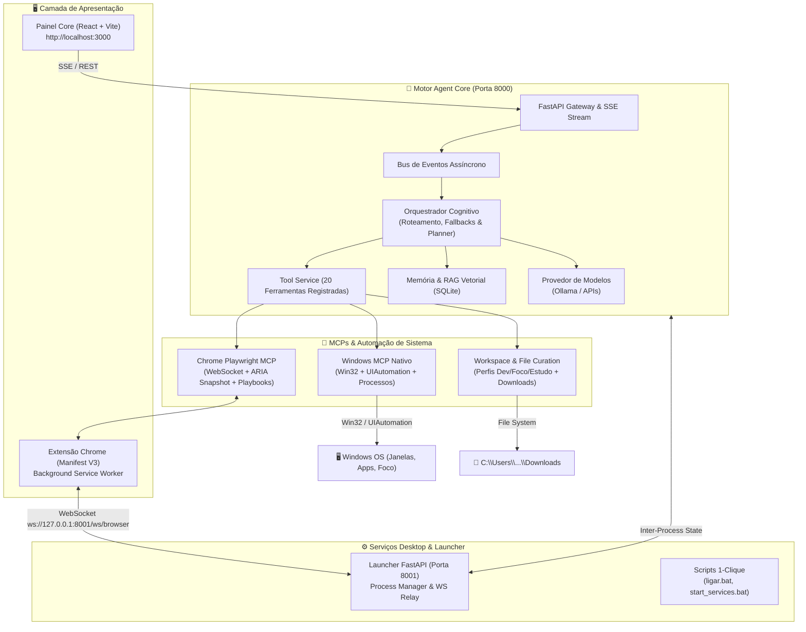

# 🤖 Agent Core — Assistente Pessoal Autônomo com MCP & Automação Nativa

[](https://www.python.org/)
[](https://fastapi.tiangolo.com/)
[](https://react.dev/)
[](https://vitejs.dev/)
[](https://www.microsoft.com/windows)

**Agent Core** é um sistema completo de assistência pessoal autônoma, local e extensível, projetado para operar diretamente no sistema operacional do usuário com alta velocidade, controle real de aplicativos e integração profunda com navegadores web.

Diferente de wrappers de IA convencionais que apenas respondem texto ou clicam cegamente na tela, o **Agent Core** combina:
1. **Modelos Locais e Abertos** (Ollama: Llama 3.2, Qwen) ou APIs em nuvem.
2. **Integração Bidirecional com Google Chrome** via WebSocket e snapshots de acessibilidade (ARIA numerado).
3. **Controle Nativo de Windows (Windows MCP)** via Win32 e Microsoft UIAutomation (sem depender de coordenadas do mouse).
4. **Macros e Automação de Alto Valor** (ambientes de trabalho automáticos e organização de arquivos).
5. **Interface Moderna** inspirada no design Harvey em React 18 + Vite.

---

## 📐 Arquitetura do Sistema



---

## 🌟 Principais Recursos

### 1. 🌐 Integração Chrome de Alta Performance & Baixa Latência
* **Canal WebSocket em Tempo Real:** Comunicação bidirecional direta (<50ms) entre o agente e a extensão do navegador, sem polling lento de 3 segundos.
* **Snapshots ARIA Numerados:** O agente analisa a árvore de acessibilidade da página ativa e enumera elementos interativos `[1]`, `[2]`, `[3]`. O clique ou preenchimento de formulário é executado com precisão cirúrgica no nó exato do DOM.
* **Playbooks de Navegação (`browser_playbooks.json`):** Memória persistente de domínio. O agente sabe como navegar no YouTube, Google e GitHub, pulando anúncios e fechando banners de cookies automaticamente sem alucinar URLs.
* **Controle de Mídia:** Pausar, reproduzir, mutar e alternar vídeos ou músicas que estejam tocando no navegador com comandos de linguagem natural.

### 2. 🪟 Windows MCP Nativo (Sem Cliques Cegos)
* **Gestão Real de Janelas:** Lista aplicativos e janelas abertas em tempo real, informando título, processo executável (`chrome.exe`, `Code.exe`), HWND e uso de memória RAM.
* **Foco e Gerenciamento Inteligente:** Traz janelas para frente (`focar_janela`), minimiza distrações, maximiza ou fecha programas sem mover o cursor físico do usuário.
* **Inspeção de Controles Nativa (UIAutomation):** Leitura de botões, caixas de diálogo e elementos gráficos de janelas desktop nativas do Windows.

### 3. 🚀 Utilidade Prática no Dia a Dia
* **Ambientes de Trabalho (Macros Inteligentes):**
  * **Modo Dev:** Abre o VS Code na pasta do projeto e o Chrome no painel local (`localhost:3000`).
  * **Modo Foco:** Dispara automaticamente uma playlist Lo-Fi relaxante e minimiza janelas de distração (Discord, Steam, etc.).
  * **Modo Estudo:** Abre bloco de notas e ferramentas de anotação rápida.
* **Curadoria Automática de Downloads:**
  * Varre a pasta de `Downloads` e move arquivos soltos para subpastas inteligentes (`Documentos_PDF`, `Documentos_Texto`, `Instaladores_e_Programas`, `Arquivos_Compactados`, `Imagens_e_Fotos`, `Midias_Audio_Video`) prevenindo sobrescritas com renomeação segura.

### 4. 🧠 Orquestrador Resiliente
* **Roteamento Inteligente:** Classifica pedidos entre simples, técnicos ou complexos.
* **Fast-Path Fallbacks Determinísticos:** Ações diretas do computador (como "organizar downloads", "modo foco", "quais janelas estão abertas" ou "pause a música") são identificadas e executadas instantaneamente sem desperdiçar tokens de LLM.
* **Memória Conversacional e RAG:** Base vetorial SQLite com busca semântica para contexto contínuo.

---

## 📂 Estrutura de Diretórios

```
agent-core-main/
├── app/                           # Backend Principal (FastAPI)
│   ├── ai/                        # Provedores de Modelo (Ollama, LM Studio, etc.)
│   ├── api/                       # Rotas HTTP, SSE, Schemas e Lifespan
│   ├── core/                      # Configurações, Segurança e Variáveis de Ambiente
│   ├── events/                    # Event Bus assíncrono e Event Gateway
│   ├── infrastructure/            # Camada de Armazenamento, SQLite e Áudio (Whisper)
│   ├── services/                  # Orquestrador, Windows MCP, Playwright MCP, Workspaces
│   └── tools/                     # Registro de Ferramentas (Tool Contracts) e Handlers
├── browser-extension/             # Extensão do Google Chrome (Manifest V3)
│   ├── manifest.json              # Metadados e permissões da extensão
│   ├── service-worker.js          # WebSocket, execução de cliques e snapshots ARIA
│   ├── popup.html / popup.js      # Interface de status da conexão
│   └── content.js                 # Scripts de injeção e manipulação do DOM
├── data/                          # Dados Persistentes
│   ├── browser_playbooks.json     # Heurísticas de navegação aprendidas por site
│   ├── browser_state.json         # Estado das abas sincronizadas
│   └── memory.db                  # Banco de dados de vetores e chats SQLite
├── docs/                          # Documentação Técnica e Guias
│   ├── ARQUITETURA.md             # Especificação arquitetural completa
│   ├── GUIA_EXTENSAO_CHROME.md    # Como instalar e utilizar a extensão
│   ├── WINDOWS_MCP.md             # Guia da automação nativa do Windows
│   └── INSTALACAO.md              # Passo a passo de instalação no Windows/Linux
├── painel-core/                   # Frontend SPA (React 18 + Vite + Tailwind)
│   ├── src/                       # Componentes visuais, chat e streaming SSE
│   ├── package.json               # Dependências do frontend
│   └── vite.config.ts             # Configuração do Vite (porta 3000)
├── launcher.py                    # Servidor FastAPI secundário (Porta 8001 & WS)
├── ligar.bat                      # Script para iniciar o backend em background
├── start_services.bat             # Script para iniciar o Launcher (8001) e o Frontend (3000)
├── desligar.bat                   # Encerra processos e libera as portas
├── requirements.txt               # Dependências Python do ecossistema
└── pyproject.toml                 # Metadados do projeto Python
```

---

## ⚡ Guia de Instalação e Uso Rápido

### 1. Pré-requisitos
* **Sistema Operacional:** Windows 10 ou 11 (para automação Win32/UIAutomation) ou Linux.
* **Python:** 3.11 ou 3.12 instalado e adicionado ao `PATH`.
* **Node.js:** Versão 18 ou superior instalado.
* **Ollama (Recomendado):** Com o modelo instalado:
  ```bash
  ollama run llama3.2:1b
  ```

### 2. Instalação das Dependências Python
No diretório raiz do projeto:
```bash
pip install -r requirements.txt
pip install pywin32 uiautomation pywinauto comtypes pyautogui websockets
```

### 3. Instalação do Frontend
Entre na pasta do painel e instale os pacotes npm:
```bash
cd painel-core
npm install
cd ..
```

### 4. Configuração do `.env`
Copie o exemplo para criar seu arquivo `.env`:
```bash
copy .env.example .env
```
*(Edite o arquivo caso queira ajustar portas ou tokens).*

### 5. Instalação da Extensão no Google Chrome
1. Abra o Google Chrome e acesse `chrome://extensions/`.
2. No canto superior direito, ative a chave **"Modo do desenvolvedor"**.
3. Clique no botão **"Carregar sem compactação"** (Load unpacked).
4. Selecione a pasta `c:\Projetos\agent-core-main\browser-extension`.
5. A extensão **Playwright MCP & Harvey Extension** estará ativa e se conectará automaticamente ao Launcher (`ws://127.0.0.1:8001/ws/browser`).

---

## 🚀 Como Executar o Sistema

Você pode iniciar o sistema completo de forma manual ou usando os arquivos executáveis em lote:

### Método 1: Inicialização em 1 Clique (Recomendado)
1. Dê um duplo-clique em **`ligar.bat`** (inicia o motor principal na porta `8000`).
2. Dê um duplo-clique em **`start_services.bat`** (inicia o Launcher na porta `8001` e o Painel Web na porta `3000`).
3. Abra seu navegador em: **`http://localhost:3000`**.

### Método 2: Inicialização Manual via Terminal

* **Terminal 1 — Backend Core (Porta 8000):**
  ```bash
  python -m uvicorn app.main:app --host 0.0.0.0 --port 8000 --env-file .env
  ```

* **Terminal 2 — Launcher & WebSocket Relay (Porta 8001):**
  ```bash
  python -m uvicorn launcher:app --host 0.0.0.0 --port 8001
  ```

* **Terminal 3 — Painel Frontend (Porta 3000):**
  ```bash
  cd painel-core
  npm run dev
  ```

---

## 🛠️ Ferramentas Registradas no Agente

O Agent Core possui 20 ferramentas integradas prontas para uso:

| Ferramenta | Categoria | Descrição |
| :--- | :--- | :--- |
| `gerenciar_janelas_windows` | Computador | Lista, foca, minimiza, maximiza ou inspeciona janelas no Windows. |
| `preparar_ambiente_trabalho` | Computador | Ativa perfis de trabalho (`dev`, `foco`, `estudo`). |
| `organizar_downloads` | Arquivos | Organiza e categoriza arquivos soltos na pasta Downloads. |
| `controlar_computador` | Computador | Abre programas autorizados no sistema (VS Code, Explorer, Terminal). |
| `pw_snapshot` | Navegador | Extrai a árvore de acessibilidade numerada `[1]`, `[2]` da página ativa. |
| `pw_clicar` | Navegador | Clica no elemento numerado ou seletor de texto do Chrome. |
| `pw_digitar` | Navegador | Digita texto em inputs do Chrome. |
| `pw_navegar` | Navegador | Abre uma nova URL no Google Chrome. |
| `pw_midia` | Navegador | Controla players de áudio/vídeo (play, pause, mute). |
| `gerenciar_abas` | Navegador | Lista abas abertas, alterna entre elas e fecha guias. |
| `pesquisar_web` | Web | Executa buscas e extrai resumos de páginas online. |
| `previsao_tempo` | Clima | Fornece dados meteorológicos em tempo real. |
| `gerenciar_notas` | Memória | Salva, consulta e apaga anotações permanentes. |
| `gerenciar_objetivo` | Metas | Registra critérios de conclusão de conversas complexas. |
| `calcular` | Matemática | Avalia expressões matemáticas com precisão. |
| `obter_hora_atual` | Sistema | Retorna a data, horário e fuso horário do sistema. |

---

## 💬 Exemplos de Comandos que Você Pode Enviar

* **Controle de Janelas:**
  > *"Quais programas estão abertos no meu computador?"*
  > *"Foque na janela do VS Code"*
  > *"Minimize o Discord"*
* **Navegação & Chrome:**
  > *"Abra o YouTube e coloque para tocar uma música lo-fi"*
  > *"Pause o vídeo"*
  > *"Leia o que está na tela"* *(o agente retorna elementos numerados)*
  > *"Clique no botão [2]"*
* **Ambiente & Produtividade:**
  > *"Modo dev"* *(abre o editor de código e o painel de controle)*
  > *"Modo foco"* *(minimiza janelas de jogos e inicia música para concentração)*
  > *"Organize meus downloads"* *(limpa e categoriza sua pasta Downloads)*

---

## 🛑 Como Encerrar os Serviços
Para desligar todos os processos e liberar as portas:
* Execute **`desligar.bat`**, ou
* No PowerShell:
  ```powershell
  Get-Process -Name python, node -ErrorAction SilentlyContinue | Stop-Process -Force
  ```

---

## 📄 Licença
Distribuído sob licença MIT. Consulte o arquivo de licença para mais detalhes.
