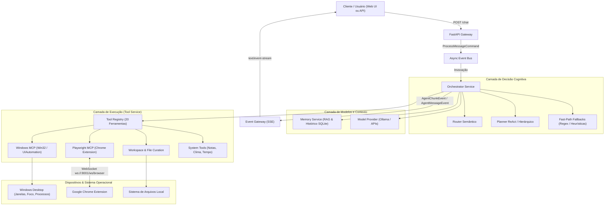

# 🏛️ Arquitetura do Sistema — Agent Core

Este documento descreve a arquitetura técnica, os contratos de interface, o ciclo de vida dos eventos e o design dos subsistemas que compõem o **Agent Core**.

---

## 1. Visão Geral da Arquitetura

O sistema é construído sobre os seguintes princípios arquiteturais:
* **Desacoplamento Orientado a Eventos (EDA):** A comunicação interna entre a recepção de requisições e a execução cognitiva é mediada por um `EventBus` assíncrono.
* **Execução Híbrida (Cognitiva + Determinística):** O agente utiliza LLMs para interpretação semântica e planejamento, mas recorre a *Fast-Path Fallbacks* determinísticos para comandos comuns de hardware e sistema operacional, garantindo latência zero e custo computacional mínimo.
* **Automação Nativa de Sistema:** Em vez de depender de heurísticas frágeis de visão computacional ou cliques cegos por coordenadas de tela (`pyautogui`), o Agent Core comunica-se diretamente com o subsistema Win32 e a API Microsoft UIAutomation.
* **Navegação Web Orientada à Acessibilidade:** A integração com o navegador é baseada em árvores ARIA numeradas e WebSocket bidirecional em tempo real, permitindo ações determinísticas no DOM.

---

## 2. Diagrama de Blocos do Sistema



---

## 3. Ciclo de Vida da Mensagem (Request Lifecycle)

1. **Recepção da Mensagem:**
   * A requisição do usuário chega ao endpoint `POST /chat` no `app/api/main.py`.
   * Um identificador único (`chat_id`) é criado ou reaproveitado.
   * Um comando `ProcessMessageCommand` é publicado no `event_bus`.
   * A conexão HTTP é convertida em um stream SSE (`StreamingResponse(event_gateway.stream_chat(chat_id))`).

2. **Roteamento e Planejamento:**
   * O `OrchestratorService` escuta o comando no `event_bus`.
   * Ele recupera o histórico da conversa e fragmentos relevantes da memória via `MemoryService`.
   * O `SemanticRouter` analisa a intenção da mensagem e classifica entre rota simples, técnica ou complexa.
   * Se a tarefa for complexa, o `Planner` elabora etapas sequenciais.

3. **Verificação de Fast-Path Fallbacks:**
   * Antes de acionar uma chamada cara ao LLM, o orquestrador verifica regras de fallback para comandos claros:
     * *Listar/Focar janelas do Windows* (`gerenciar_janelas_windows`)
     * *Controle de mídia e reprodução no YouTube* (`pw_midia`, `pw_navegar`)
     * *Ambientes de trabalho* (`preparar_ambiente_trabalho`)
     * *Organização de arquivos* (`organizar_downloads`)
     * *Abertura de aplicativos locais* (`controlar_computador`)
   * Se um fallback for disparado, a ferramenta é executada imediatamente sem latência de inferência.

4. **Inferência do Modelo e Tool Calling:**
   * Caso o comando exija raciocínio semântico, os schemas das ferramentas autorizadas são enviados ao `ModelProvider`.
   * Os tokens de resposta e etapas de raciocínio (*thinking*) são emitidos via `AgentChunkEvent` em tempo real para a interface gráfica.
   * Se o modelo invocar uma ferramenta (`tool_calls`), o `ToolService` executa o manipulador correspondente e devolve o resultado para que o modelo formule a resposta final.

5. **Armazenamento e Conclusão:**
   * A mensagem final do assistente, com metadados de rota, tempo e ferramentas executadas, é persistida no `ChatService`.
   * O evento `AgentMessageEvent` encerra a transmissão no cliente.

---

## 4. Subsistemas em Detalhe

### 4.1. Windows MCP & UI Automation (`windows_mcp_service.py`)
O serviço opera em nível nativo no sistema operacional Windows:
* **Enumeração de Janelas:** Utiliza `win32gui.EnumWindows` e `win32process.GetWindowThreadProcessId` para coletar o identificador de janela (HWND), título visível, processo executável (`chrome.exe`, `Code.exe`) e consumo de memória RAM via `psutil`.
* **Manipulação de Foco:** Utiliza `win32gui.ShowWindow` (`SW_RESTORE`) e `win32gui.SetForegroundWindow` para ativar janelas sem exigir movimento de mouse.
* **Inspeção de Controles Nativa:** A biblioteca `uiautomation` mapeia a árvore de acessibilidade dos controles Win32/WPF/UWP da janela solicitada.

### 4.2. Playwright MCP & Integração Chrome (`playwright_mcp_service.py`)
A integração com o navegador não depende de drivers externos lentos (como Selenium ou instâncias secundárias de Chromium):
* **Extensão Manifest V3:** Conecta-se diretamente ao Launcher do agente via WebSocket em `ws://127.0.0.1:8001/ws/browser`.
* **Snapshots ARIA com Numeração Sequencial:** Um script leve percorre nós interativos da aba ativa e gera um mapa de elementos com índices discretos:
  ```text
  [1] button 'Pesquisar'
  [2] link 'Vídeos Recentes'
  [3] input 'Digite seu texto'
  ```
* **Disparo Instantâneo de Ações:** O agente executa `pw_clicar(seletor="1")` ou `pw_digitar(seletor="3", texto="...")`. O comando é transmitido via WebSocket, executado em milissegundos pela extensão e o resultado retornado síncronamente ao LLM.
* **Playbooks de Domínio:** Persistidos em `data/browser_playbooks.json`, permitem pular anúncios, fechar modais de consentimento de cookies e focar o conteúdo de sites populares sem necessidade de instruções repetidas.

### 4.3. Workspace & Curadoria de Arquivos (`workspace_service.py`)
* **Gerenciamento de Ambientes:**
  * `dev`: Aciona `code .` e navega para `localhost:3000`.
  * `foco`: Minimiza janelas secundárias (Discord, Steam) e inicia streaming musical ambiente.
  * `estudo`: Abre ferramentas de texto e leitura.
* **Organizador de Downloads:**
  * Varre `Path.home() / "Downloads"`.
  * Mapeia extensões para pastas padronizadas (`Documentos_PDF`, `Documentos_Texto`, `Instaladores_e_Programas`, `Arquivos_Compactados`, `Imagens_e_Fotos`, `Midias_Audio_Video`).
  * Em caso de colisão de nomes, renomeia com sufixo numérico sem sobrescrever nem corromper dados do usuário.

---

## 5. Portas e Comunicação de Rede

| Porta | Protocolo | Serviço | Descrição |
| :--- | :--- | :--- | :--- |
| **8000** | HTTP / SSE | Backend Principal (`app.main:app`) | API REST, SSE streaming e orquestração. |
| **8001** | HTTP / WS | Launcher (`launcher:app`) | Gerenciador de processos e WebSocket para o Chrome. |
| **3000** | HTTP | Painel Core (`Vite / React`) | Interface do usuário principal. |
| **11434**| HTTP | Ollama (Local) | Provedor de inferência local padrão. |

---

## 6. Persistência de Dados

* `data/memory.db`: Banco de dados SQLite contendo histórico de chats, mensagens e tabelas de embeddings.
* `data/browser_playbooks.json`: Regras de automação por domínio.
* `data/browser_state.json`: Snapshot de abas abertas e ativas sincronizadas.
* `comandos_pc.json`: Registro de programas autorizados e atalhos de inicialização rápida do Windows.
